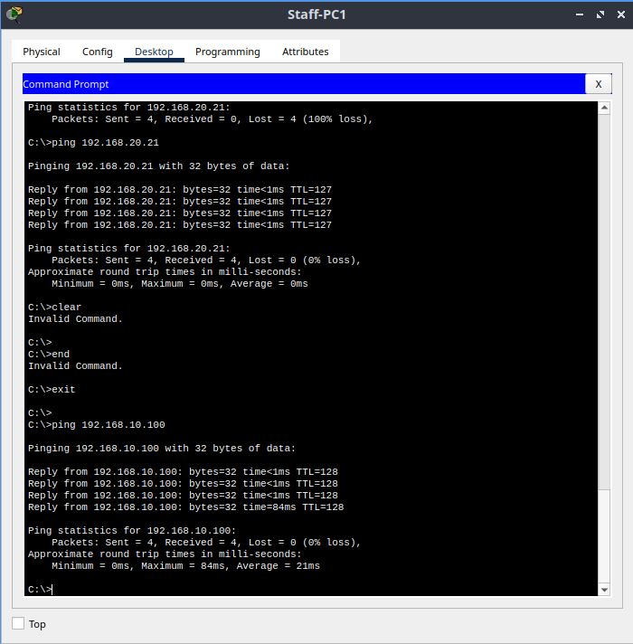
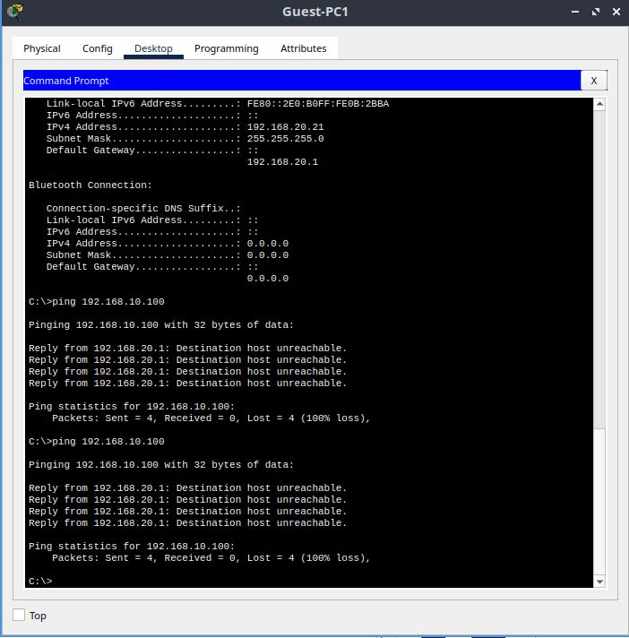
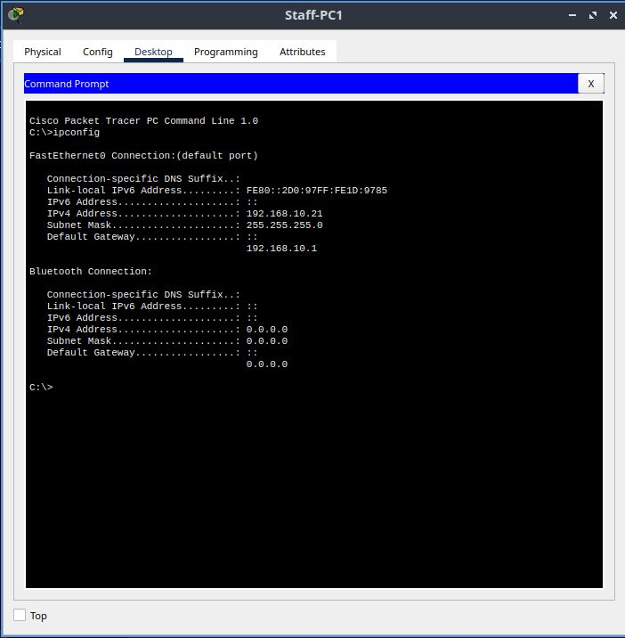
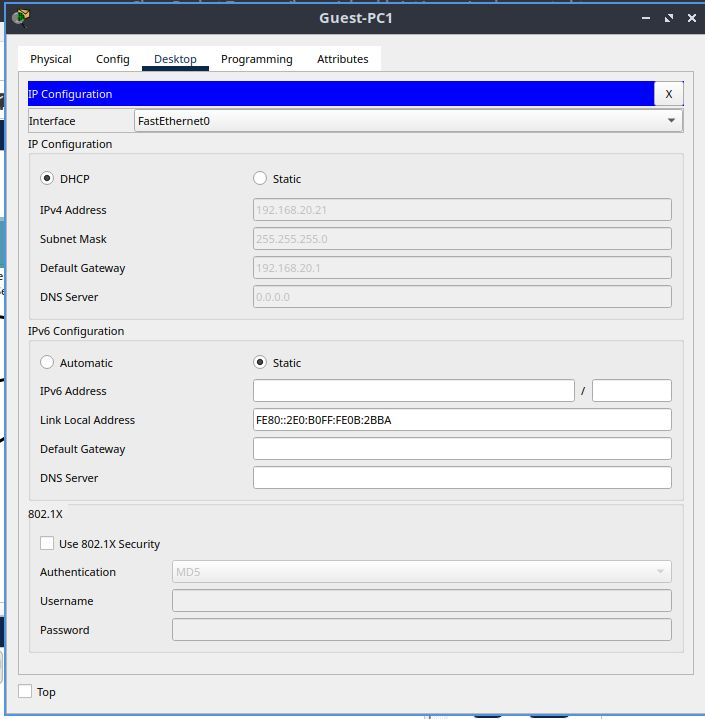

# Cybrarians November Challenge: Office Network (VLANs)

**Name:** Lawal Abdulquadri Olamide  
**Department/Level:** Computer Science / 400 Level  
**Date submitted:** 10 November 2026

## What I Built
I built a simulated office network using Cisco Packet Tracer. It consists of 12 PCs divided into two VLANs (6 Staff PCs and 6 Guest PCs), two switches, one router, and one Staff Server.

## Tasks Completed
- [x] VLANs created and ports assigned
- [x] Trunk between switches
- [x] Router-on-a-stick (inter-VLAN routing)
- [x] DHCP for both VLANs
- [x] ACL blocking Guests from Staff and the server
- [x] Bonus: port security
- [x] Bonus: switch login passwords

## IP Plan

| VLAN | Network | Gateway |
|---|---|---|
| 10 Staff | 192.168.10.0/24 | 192.168.10.1 |
| 20 Guests | 192.168.20.0/24 | 192.168.20.1 |

## Proof

### Staff pinging the server (success)

### Guest pinging the server (blocked)

### Staff DHCP proof

### Guest DHCP proof

## Challenges I Faced
Configuring the ACL initially affected communication between Staff and Guest PCs. I resolved this by allowing ICMP echo replies while keeping Guest access to Staff devices restricted.

I also encountered an issue with sticky MAC address learning, which I resolved by generating network traffic.

## Files
- `Lawal_AbdulQuadri_VLAN_Challenge.pkt`
